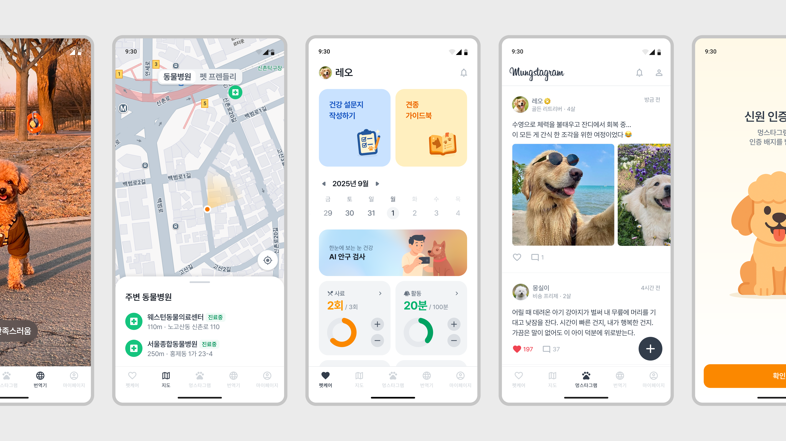
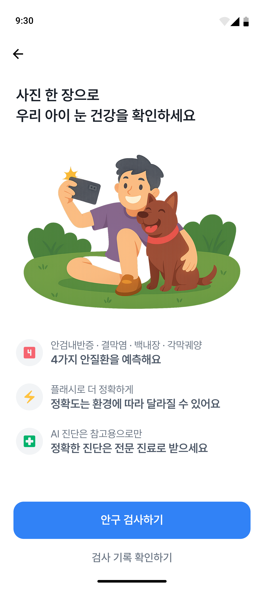
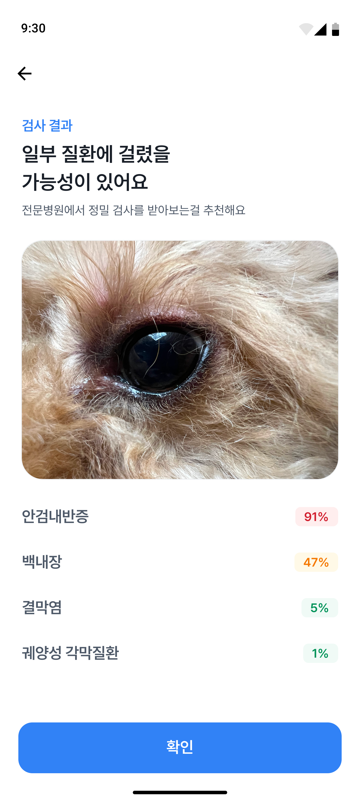
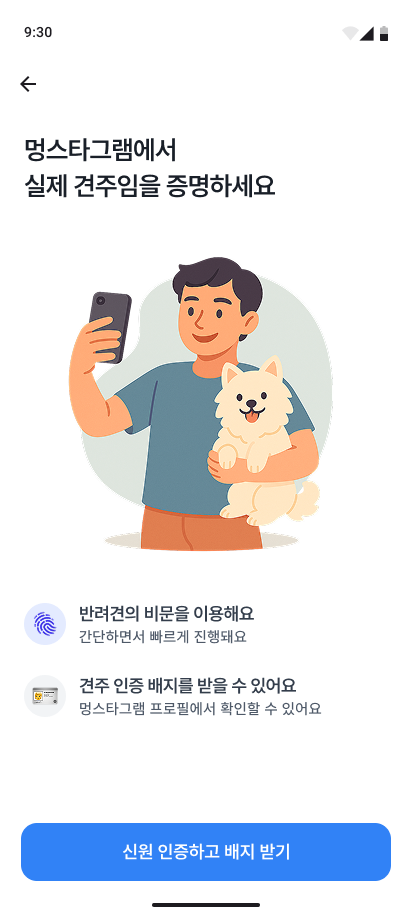
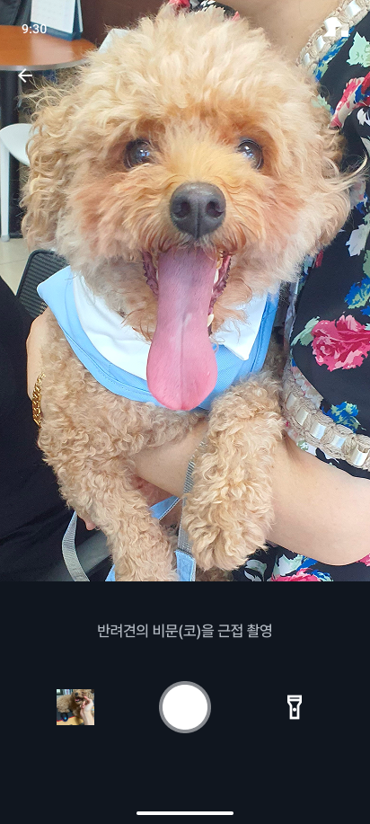
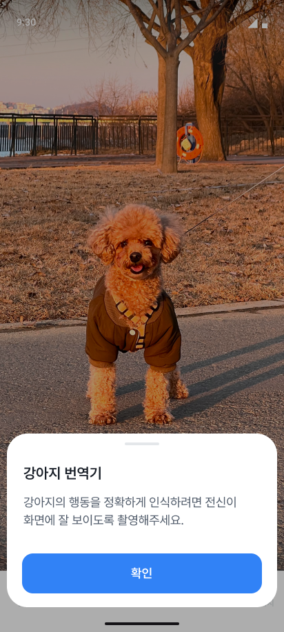
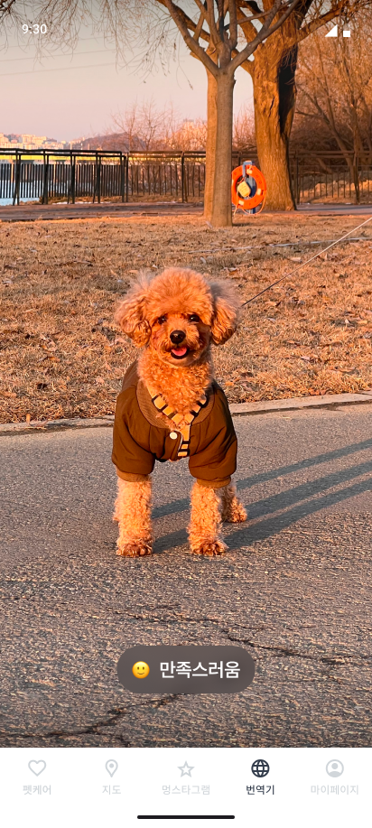

# 행복하개 (Happy-Dog)

초보 견주를 위해 건강 관리, 주변 시설 지도, 커뮤니티, 행동 해석을 한 곳에서 제공하는 AI 펫케어 안드로이드 애플리케이션입니다.

2025 동양미래대학교 컴퓨터공학부 인공지능소프트웨어학과 졸업작품 · 팀 식스센스

## What it does

* 사료·활동·체중 등 건강 지표를 기록하고, 견종 백과사전과 건강 설문지를 제공합니다.
* 눈 사진으로 결막염·백내장·궤양성 각막질환·안검내반증 가능성을 추정합니다. (임상 진단을 대체하지 않는 보조 도구)
* 사용자 위치 기준으로 주변 동물병원과 반려견 동반 가능 시설을 보여줍니다.
* 비문 등록으로 견주를 인증하는 강아지 전용 SNS(멍스타그램)를 제공합니다.
* 반려견 행동 영상을 분석해 감정과 상태를 자연어로 보여줍니다. (강아지 번역기)

## Tech Stack

* Frontend: Kotlin, Android Studio
* Backend: Python, Flask
* AI: PyTorch, TensorFlow
* Database / Storage: Firebase Firestore, Firebase Storage
* Design / Tools: Figma, GitHub, Postman

## Screenshots

#### [펫케어 - 안구 검사 / 기록 / 백과사전]

  
  
  

#### [멍스타그램]

  
  

#### [강아지 번역기]

  
  

## Key Files

* `[안구 질환 분석 모델 파일]`: 안구 이미지 전처리 후 EfficientNet-B0으로 질환별 확률 산출
* `[비문 인식 모델 파일]`: 비문 영역 검출·크롭 후 임베딩 코사인 유사도로 동일 개체 인증
* `[행동 분석 모델 파일]`: 영상에서 2D 키포인트를 추출하고 LSTM으로 감정·상태 분류
* `[Flask 서버 파일]`: 모델 추론 API
* `[Android 앱 모듈]`: 앱 화면 및 서버 연동

## Portfolio Highlights

* ResNet50, EfficientNet-B0, ViT를 비교 실험해 정확도가 가장 높은 EfficientNet-B0을 안구 질환 분류기로 채택
* 모든 질환의 예측 확률이 40% 이하이면 정상으로 판정하는 기준 설계
* 분류, 인증, 행동 분석 등 서로 다른 AI 모델 3종을 하나의 모바일 서비스로 통합
* 6인 팀 프로젝트로 Android, Flask, Firebase 연동 개발

## Team (식스센스)

| 이름 | 역할 |
|---|---|
| 김유진 | AI, 프론트엔드 |
| 심수현 | 프론트엔드 |
| 김보성 | AI, 프론트엔드 |
| 박정호 | AI, 백엔드 |
| 김민결 | UI/UX, 프론트엔드 |
| 김동연 | 프론트엔드 |

지도교수: 조진형

## Notes

* 안구 질환 스크리닝은 임상 진단을 대체하지 않는 보조 도구입니다.
* 현재는 별도로 배포되어 있지 않으며, 위 스크린샷은 개발 당시 실행 화면입니다.
* 2025 동양미래대학교 컴퓨터공학부 졸업작품집 수록 프로젝트입니다.
